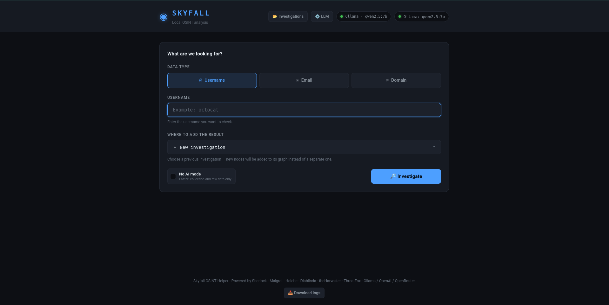
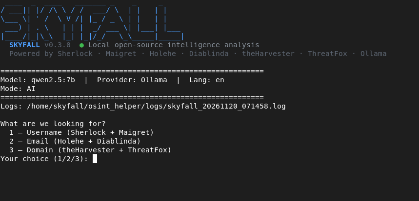
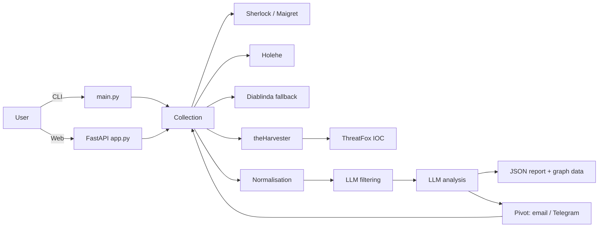

# Skyfall — OSINT Helper

> “Skyfall, when it crumbles...”
> — Adele

**Skyfall** is a local OSINT tool for collecting and analysing public data by
username, email address, or domain. Collection runs on your machine and the
LLM stage can use either a local model through [Ollama](https://ollama.com/) or
a cloud provider (OpenAI / OpenRouter).

WEB INTERFACE

CLI INTERFACE


<sub>Screenshots are illustrative and use fictional data.</sub>

---

## Features

- **Username** — Sherlock + Maigret: 3000+ sites, bios, full names, followers,
  profile creation dates.
- **Email** — Holehe; if Holehe finds nothing, Diablinda is used as a fallback
  to recover usernames, avatars, bios, and profile links.
- **Domain** — theHarvester: emails, subdomains, hosts, and IPs; automatic IOC
  lookup in ThreatFox.
- **Raw Mode** — skip LLM filtering and analysis entirely (web checkbox or
  `--no-ai` in the CLI). Collection still runs and raw data is returned.
- **LLM filtering and analysis** — remove noise before analysis, then extract
  entities, connection hypotheses, contradictions, uncertainties, and a
  reasoning tree.
- **Cloud LLMs** — OpenAI and OpenRouter (`gpt-4o-mini`,
  `anthropic/claude-3.5-sonnet`, and any compatible model).
- **Web-managed LLM settings** — switch provider, enter an API key, set a base
  URL, and choose a model directly in the browser; no file editing required.
- **Resilient by design** — if the LLM is unavailable or exceeds its timeout,
  Skyfall falls back to raw results instead of failing the investigation.
- **Live investigation graph** — Obsidian-style cards with a number, type,
  label, and colour; curved edges, zoom, pan, drag, and manual layouts.
- **Sequential investigations** — run a username search, then an email search,
  and merge the second result into the first graph.
- **Custom nodes and manual links** — create your own node with a source link,
  then connect it to any existing node.
- **Notes and sources** — every node and every edge can carry a note and a
  source URL.
- **Full HTML snapshots** — save the complete analysis page to `saved_pages/`.
- **End-to-end logging** — CLI, API, and every external tool write to
  `~/osint_helper/logs/`; the latest log can be downloaded from the web UI.
- **Two interfaces** — CLI (`main.py`) and FastAPI + HTML/JS (`app.py`).
- **Localisation** — English and Russian UI for both the CLI and the web
  interface (`--lang en|ru`, `OSINT_LANG`). The whole web UI is translated,
  including dynamic toasts, modals, graph panels, and LLM settings.

---

## Architecture



### Components

| Layer | Technology | Purpose |
|---|---|---|
| Web UI | FastAPI, Jinja2, HTML/CSS/JS | Form, progress, report, graph, LLM settings |
| CLI | Python 3.10+ | Interactive menu, terminal report, recursive pivot |
| Collection | Sherlock, Maigret, Holehe, Diablinda, theHarvester | Profiles, email accounts, domain infrastructure |
| Enrichment | ThreatFox (abuse.ch) | Malware/C2 checks for domains and IPs |
| Analysis | Ollama / OpenAI / OpenRouter | Noise filtering and OSINT analysis (or Raw Mode) |
| Graph storage | JSON in `investigations/` | Nodes, edges, notes, card positions |
| Visualisation | networkx + matplotlib | Dark PNG graph via `graph.py` |

---

## Requirements

- Python **3.10+**
- A running local **Ollama** server, or an OpenAI/OpenRouter API key
- External OSINT tools installed separately (see below)
- For local LLMs: enough RAM/VRAM for the chosen model. A 7B Q4 model needs
  roughly 5–6 GB of free memory; context size also consumes memory.

> **CPU-only performance warning.** A 7B model on a 4-core CPU with 8 GB RAM
> can take minutes to load and several minutes to generate a response. Skyfall
> uses compact prompts, output caps, and Raw fallback to stay usable, but cloud
> LLMs or smaller local models are strongly recommended for interactive use.

---

## Installation

### 1. Python dependencies

```bash
git clone <your-repo-url> skyfall
cd skyfall

python3 -m venv venv
source venv/bin/activate        # Windows: venv\Scripts\activate

pip install -r requirements.txt
```

`requirements.txt` contains: `fastapi`, `uvicorn`, `jinja2`, `requests`,
`networkx`, `matplotlib`, `python-multipart`, `pydantic`.

### 2. External OSINT tools

```bash
pipx install holehe
pipx install maigret
pipx install sherlock-project
```

**theHarvester** (5.x):

```bash
git clone https://github.com/laramies/theHarvester.git
cd theHarvester
python3 -m venv .venv
source .venv/bin/activate
pip install -r requirements.txt
cd ..
```

Skyfall looks for theHarvester in `PATH`, then in
`~/theHarvester/.venv/bin/theHarvester`, then in
`~/theHarvester/bin/theHarvester`. To use a custom path:

```bash
export THEHARVESTER_BIN="/full/path/to/theHarvester"
```

**Diablinda** (Node.js 18+):

```bash
# without a global install:
npx diablinda --help

# or globally:
npm install -g diablinda
export DIABLINDA_BIN="$(which diablinda)"
```

If `npx`/`diablinda` is unavailable, Skyfall simply skips the email fallback;
Holehe remains the primary email tool.

### 3. Ollama (local LLM)

```bash
# install: https://ollama.com/download
ollama pull qwen2.5:7b
ollama serve
```

Verify:

```bash
curl http://localhost:11434/api/tags
```

Optional overrides:

```bash
export OLLAMA_MODEL="qwen2.5:7b"
export OLLAMA_URL="http://localhost:11434/api/generate"
```

### 4. Cloud LLM (optional)

You can configure a cloud provider in two ways.

**Option A — from the web UI (recommended):**

1. Open Skyfall and click **⚙️ LLM** in the header.
2. Select `OpenAI` or `OpenRouter`.
3. Enter the API key, base URL, and model.
4. Click **Save**. Click **Check** to test the connection.

Skyfall writes the settings to `llm_settings.json` in the project directory
(file mode `600`). The API key is stored locally and is never returned in full
by the API — only a masked form such as `••••••abcd` is shown.

**Option B — environment variables:**

```bash
export LLM_PROVIDER="openai"          # ollama | openai | openrouter
export OPENAI_API_KEY="sk-..."
# or:
export OPENROUTER_API_KEY="sk-or-..."

export OPENAI_BASE_URL="https://api.openai.com/v1"
export OPENAI_MODEL="gpt-4o-mini"
```

For OpenRouter:

```bash
export LLM_PROVIDER="openrouter"
export OPENROUTER_API_KEY="sk-or-..."
export OPENAI_BASE_URL="https://openrouter.ai/api/v1"
export OPENAI_MODEL="anthropic/claude-3.5-sonnet"
```

**Precedence:** values saved by the web UI in `llm_settings.json` override
environment variables. Delete that file to return to environment/default
values.

### 5. ThreatFox (optional, for domains)

1. Get a free Auth-Key: <https://auth.abuse.ch/>.
2. Export it:

```bash
export THREATFOX_KEY="your-key"
```

Without a key, domain collection still works; only the ThreatFox IOC lookup is
skipped with a clear message. The key is never stored in the repository.

---

## Running

### Web interface

```bash
source venv/bin/activate

python app.py                 # Russian UI (default)
python app.py --lang en       # English UI
python app.py --lang en --port 8000

# Or with an environment variable:
OSINT_LANG=en python app.py
```

Open <http://127.0.0.1:8000>. Interactive API documentation is available at
<http://127.0.0.1:8000/docs>.

The language is **server-wide**: one running process renders one language.
When using the uvicorn CLI directly, pass the language through the environment
because uvicorn does not know Skyfall's `--lang` flag:

```bash
OSINT_LANG=en uvicorn app:app --host 127.0.0.1 --port 8000
```

For development with auto-reload:

```bash
uvicorn app:app --reload --host 127.0.0.1 --port 8000
```

> After updating Skyfall, restart the backend. A process started before the
> update still serves the old API (for example, `/api/settings/llm` returns
> 404) even though static HTML/CSS/JS files are read from disk on each request.

### CLI

```bash
source venv/bin/activate
python main.py
python main.py --lang en
python main.py --no-ai
```

`--no-ai` enables Raw Mode for that CLI run. The same effect is available
globally with `OSINT_USE_AI=0`.

On startup, the CLI clears the terminal screen and scrollback so the Skyfall
banner appears on a clean screen. This only happens in an interactive terminal:
output redirected to a pipe or file is left untouched. Set `OSINT_NO_CLEAR=1`
to disable clearing.

---

## Web UI guide

1. Choose **Username**, **Email**, or **Domain**.
2. Enter the value. The progress message is type-aware:
   - username → **Sherlock + Maigret**;
   - email → **Holehe**, then **Diablinda** if Holehe finds nothing;
   - domain → **theHarvester + ThreatFox**.
3. Optional: enable **No AI mode** to skip LLM filtering and analysis.
4. Click **Investigate**.
5. Review the summary, entities, connections, filtering results, and graph.
6. Click a graph card to open a small panel with:
   - description and source URL;
   - a note field (saved automatically);
   - **Link**, **Edit**, and **Delete** actions.
7. To continue an investigation:
   - select a previous investigation under **Where to add the result**;
   - optionally choose an existing node under **Link the new request to a node**;
   - run the next search.
8. Use **＋ Node** to create a custom node and **🔗 Link** to connect two nodes.
   Drag cards, pan the background, and use the mouse wheel to zoom.
9. **💾 Save page** writes a complete static HTML snapshot (inline CSS and the
   graph) to `saved_pages/`. Saved pages are listed under **📂 Investigations**.
10. **⚙️ LLM** opens provider settings. **📥 Download logs** in the footer
    downloads the latest log file.

---

## CLI guide

```text
1 — Username (Sherlock + Maigret)
2 — Email (Holehe + Diablinda fallback)
3 — Domain (theHarvester + ThreatFox)
```

After the report, Skyfall offers recursive pivoting:

```text
🔄 New entities found (email, Telegram channels):
   1. alice@example.com
   2. Telegram: @alice_wonder
Continue investigation on them? (y/n):
```

Pivot depth is limited to 3. Each JSON report records its place in the chain:

```json
{
  "depth": 2,
  "parent_report": "/path/to/output/report_alice_20261118_171000.json",
  "mode": "ai",
  "llm_provider": "ollama"
}
```

The CLI prints the log file path on startup.

---

## Raw Mode

Raw Mode skips `filter_sites()` and `analyze_filtered()`. It returns:

- `filtered.kept` — every collected site;
- `filtered.dropped` — empty;
- `analysis.summary` — `"Режим без AI (Raw Mode)"`;
- deterministic `entities`, `connections`, and `tree`, so the graph still works.

Enable it:

- Web: **No AI mode** checkbox;
- API: `"use_ai": false`;
- CLI: `--no-ai`;
- global default: `OSINT_USE_AI=0`.

If the AI stage fails or times out while Raw Mode is off, Skyfall automatically
performs a **Raw fallback** (`mode = "raw_fallback"`), filling the graph with
deterministic entities and connections.

---

## Web localisation

The web UI supports Russian and English through a server-wide language
setting:

```bash
python app.py --lang en    # English UI
python app.py --lang ru    # Russian UI
OSINT_LANG=en python app.py
```

How it works:

- static HTML is rendered server-side with Jinja `wt()` translations;
- dynamic JavaScript messages use `tr()` / `tf()` and a translation map
  injected into the page;
- the `<html lang>` attribute, date formatting, buttons, modals, graph panels,
  progress messages, and LLM settings are all localized;
- compact LLM prompts switch to English when the UI language is English, so
  filtering and analysis summaries come back in English;
- raw-mode and local fallback messages are localized as well.

User-supplied data (nicknames, notes, URLs) and external OSINT content are
never translated. A single server process uses a single language; start
another process on a different port if you need both languages at once.

---

## Configuration reference

All variables are optional. Values managed by the web UI are stored in
`llm_settings.json` and take precedence over environment variables.

| Variable | Default | Purpose |
|---|---|---|
| `OSINT_USE_AI` | `1` | `0` disables AI globally (Raw Mode) |
| `OLLAMA_URL` | `http://localhost:11434/api/generate` | Ollama generate endpoint |
| `OLLAMA_MODEL` | `qwen2.5:7b` | Local model name |
| `OLLAMA_NUM_CTX` | `4096` | Context window; lower = less RAM |
| `OLLAMA_NUM_PREDICT` | `1200` | Generic output-token cap |
| `OLLAMA_FILTER_NUM_PREDICT` | `200` | Output cap for filtering |
| `OLLAMA_ANALYZE_NUM_PREDICT` | `450` | Output cap for analysis |
| `OLLAMA_KEEP_ALIVE` | `15m` | How long Ollama keeps the model loaded |
| `OLLAMA_FILTER_TIMEOUT` | `300` | Filter timeout, seconds |
| `OLLAMA_ANALYZE_TIMEOUT` | `420` | Analysis timeout, seconds |
| `LLM_PROVIDER` | `ollama` | `ollama`, `openai`, or `openrouter` |
| `OPENAI_API_KEY` | — | OpenAI key (or OpenRouter-compatible key) |
| `OPENROUTER_API_KEY` | — | Alternative to `OPENAI_API_KEY` |
| `OPENAI_BASE_URL` | `https://api.openai.com/v1` | Cloud API base URL |
| `OPENAI_MODEL` | `gpt-4o-mini` | Cloud model |
| `OPENAI_FILTER_TIMEOUT` | `120` | Cloud filter timeout, seconds |
| `OPENAI_ANALYZE_TIMEOUT` | `180` | Cloud analysis timeout, seconds |
| `OSINT_MAX_FILTER_SITES` | `20` | Max sites sent to the filtering LLM |
| `OSINT_MAX_ANALYZE_SITES` | `15` | Max sites sent to the analysis LLM |
| `OSINT_MAX_OBSERVATIONS` | `15` | Max observation lines sent to the LLM |
| `OSINT_OUTPUT_DIR` | `./output` | JSON report directory |
| `OSINT_INVESTIGATIONS_DIR` | `./investigations` | Graph storage |
| `OSINT_SAVED_PAGES_DIR` | `./saved_pages` | HTML snapshots |
| `OSINT_SETTINGS_FILE` | `./llm_settings.json` | Web-managed LLM settings |
| `OSINT_LOG_DIR` | `~/osint_helper/logs` | Log directory |
| `OSINT_LOG_LEVEL` | `INFO` | Log level (`DEBUG`, `INFO`, `WARNING`, ...) |
| `OSINT_NO_CLEAR` | — | `1` disables terminal clearing on CLI startup |
| `THREATFOX_KEY` | — | ThreatFox Auth-Key |
| `THREATFOX_URL` | `https://threatfox-api.abuse.ch/api/v1/` | ThreatFox endpoint |
| `THEHARVESTER_BIN` | auto-detect | Path to theHarvester |
| `DIABLINDA_BIN` | `npx --yes diablinda` | Path to Diablinda |
| `OSINT_LANG` | auto-detect | Interface language: `ru` or `en` |

Example `.env`:

```bash
OSINT_USE_AI=1

OLLAMA_URL=http://localhost:11434/api/generate
OLLAMA_MODEL=qwen2.5:7b
OLLAMA_NUM_CTX=4096
OLLAMA_FILTER_TIMEOUT=300
OLLAMA_ANALYZE_TIMEOUT=420

LLM_PROVIDER=ollama
# OPENAI_API_KEY=
# OPENROUTER_API_KEY=
# OPENAI_BASE_URL=https://api.openai.com/v1
# OPENAI_MODEL=gpt-4o-mini

OSINT_OUTPUT_DIR=./output
OSINT_INVESTIGATIONS_DIR=./investigations
OSINT_SAVED_PAGES_DIR=./saved_pages

THREATFOX_KEY=
```

Skyfall does **not** load `.env` automatically. Export the variables in your
shell (`source .env`) or use a service manager such as systemd
`EnvironmentFile=`.

---

## LLM performance tuning

The original filtering request asked the model for a full JSON object for every
site. On a 7B CPU-only model, a 16–86-site result could exceed ten minutes and
hit the request timeout. Skyfall now uses a compact protocol:

- the filter receives numbered sites and returns **only index numbers**:
  `{"keep": [1, 2, 5], "thinking": "..."}`;
- full site objects, URLs, and metadata are reconstructed from the original
  data in Python;
- priority order is: sites with metadata first, then STRONG, MEDIUM, unknown;
- only 20 candidates go to the filter and 15 to the analysis by default;
- observations and metadata values are trimmed;
- context defaults to 4096 instead of 8192;
- output tokens are capped per stage;
- STRONG/MEDIUM sites and sites with metadata cannot be lost even if the model
  drops them;
- on timeout/error, the investigation falls back to deterministic raw results.

Recommended tuning:

| Situation | Recommendation |
|---|---|
| 8 GB RAM, CPU only | `OLLAMA_NUM_CTX=2048`–`4096`, a 3B/7B Q4 model, or Raw Mode |
| 16 GB RAM, CPU only | 7B Q4 is usable, but expect minutes per AI stage |
| GPU with 8 GB+ VRAM | 7B–8B Q4 models are comfortable |
| Large result sets (50+ sites) | Lower `OSINT_MAX_FILTER_SITES` / `OSINT_MAX_ANALYZE_SITES` |
| Repeated searches | Keep `OLLAMA_KEEP_ALIVE=15m` or higher to avoid reloading |
| Interactive work | Use a cloud provider or Raw Mode |

Useful knobs:

```bash
export OLLAMA_NUM_CTX=2048
export OLLAMA_FILTER_NUM_PREDICT=200
export OLLAMA_ANALYZE_NUM_PREDICT=450
export OLLAMA_FILTER_TIMEOUT=300
export OLLAMA_ANALYZE_TIMEOUT=420
export OSINT_MAX_FILTER_SITES=20
export OSINT_MAX_ANALYZE_SITES=15
```

If your machine still times out, set `OSINT_USE_AI=0` or use the web
**No AI mode**. Raw Mode is always faster because it only runs the collection
tools.

### Why a long timeout may still be acceptable

Model loading itself can take minutes on a slow disk. The first request after a
cold start is the slowest. `keep_alive=15m` avoids reloading the model between
filtering and analysis and between nearby searches. A timeout does not discard
the investigation: the API returns `mode="raw_fallback"` with collected data.

---

## Reports and storage

| Path | Contents |
|---|---|
| `output/report_<value>_<timestamp>.json` | Full report for one search |
| `output/maigret_<username>/` | Maigret Markdown/HTML reports |
| `investigations/<id>.json` | Live investigation: nodes, edges, notes, positions, searches |
| `saved_pages/<name>_<timestamp>.html` | Static HTML snapshot of the analysis page |
| `llm_settings.json` | Web-managed LLM settings (may contain an API key) |
| `~/osint_helper/logs/skyfall_*.log` | Rotating logs |

All runtime data directories are ignored by Git. The API key file is created
with mode `600`; never commit it.

---

## Logging and diagnostics

- Logs are written to `~/osint_helper/logs/skyfall_YYYYMMDD_HHMMSS.log`
  (override with `OSINT_LOG_DIR`).
- Rotation: 10 MB per file, at most 5 files (current + 4 backups).
- Format:

```text
2026-11-19 14:00:00,123 [INFO] main: Investigation start: type=username value=alice ...
```

- Logged events: investigation start/finish, each tool start/finish and counts,
  errors with tracebacks, LLM provider/model, prompt and response previews
  (500 chars each), generation time, fallback reason, report path.
- If the home directory is not writable, the logger automatically falls back to
  a temporary directory.
- Web: **📥 Download logs** in the footer, or `GET /api/logs`.
- CLI: the active log path is printed at startup.

For debugging, set `OSINT_LOG_LEVEL=DEBUG`.

---

## API reference

```http
GET    /api/health
POST   /api/investigate
GET    /api/logs

GET    /api/settings/llm
POST   /api/settings/llm
POST   /api/settings/llm/test

GET    /api/investigations
POST   /api/investigations
GET    /api/investigations/{id}
PATCH  /api/investigations/{id}
DELETE /api/investigations/{id}

POST   /api/investigations/{id}/nodes
PATCH  /api/investigations/{id}/nodes/{node_id}
DELETE /api/investigations/{id}/nodes/{node_id}

POST   /api/investigations/{id}/edges
PATCH  /api/investigations/{id}/edges/{edge_id}
DELETE /api/investigations/{id}/edges/{edge_id}

POST   /api/investigations/{id}/import
POST   /api/investigations/{id}/positions
POST   /api/investigations/{id}/save-page
POST   /api/investigations/{id}/import-report
GET    /api/reports
GET    /api/pages
GET    /pages/{filename}
```

### Run an investigation

```bash
curl -X POST http://127.0.0.1:8000/api/investigate \
  -H "Content-Type: application/json" \
  -d '{"input_type": "username", "value": "alice_wonder", "language": "ru", "use_ai": true}'
```

Raw Mode:

```bash
curl -X POST http://127.0.0.1:8000/api/investigate \
  -H "Content-Type: application/json" \
  -d '{"input_type": "email", "value": "alice@example.com", "use_ai": false}'
```

### Change the LLM from the API

```bash
curl -X POST http://127.0.0.1:8000/api/settings/llm \
  -H "Content-Type: application/json" \
  -d '{
    "provider": "openrouter",
    "api_key": "sk-or-...",
    "base_url": "https://openrouter.ai/api/v1",
    "model": "anthropic/claude-3.5-sonnet"
  }'
```

`api_key` may be omitted or empty to keep the existing key. Use
`"clear_api_key": true` to remove it. The response masks the key.

Test the active provider:

```bash
curl -X POST http://127.0.0.1:8000/api/settings/llm/test
```

### Health response

`GET /api/health` returns:

```json
{
  "status": "ok",
  "ollama_model": "qwen2.5:7b",
  "ollama_available": true,
  "llm_provider": "ollama",
  "llm_model": "qwen2.5:7b",
  "llm_available": true,
  "use_ai": true
}
```

---

## Tests

```bash
source venv/bin/activate
python -m unittest discover -s tests -v
```

Tests do not access the network or run external tools: `subprocess` and
`requests` are mocked. Covered areas:

- Holehe, theHarvester, and Diablinda parsers;
- ThreatFox;
- normalisation and empty-result protection;
- recursive pivot, `depth`, and `parent_report`;
- live investigations: nodes, edges, notes, second-search import, positions,
  HTML snapshot saving;
- Raw Mode and Raw fallback;
- OpenAI request/response shape, missing-key errors, cloud health check;
- compact filter/analysis protocols and JSON repair;
- rotating logger and LLM settings persistence.

---

## Troubleshooting

### “LLM timeout” during filtering or analysis

- This is expected on slow CPU-only machines with a 7B model.
- Skyfall returns `mode="raw_fallback"` with collected data instead of failing.
- Lower `OLLAMA_NUM_CTX`, use a smaller model (`qwen2.5:3b`), raise the timeout,
  or switch to a cloud provider / Raw Mode.
- Check the log for `eval_count`, `prompt_eval`, and `load` statistics.

### Ollama is not reachable

```bash
systemctl status ollama
ollama serve
curl http://localhost:11434/api/tags
```

The web header shows the provider/model and a red/green status dot.

### Cloud provider returns 401/403

- Verify the API key and provider selection.
- For OpenRouter, use `https://openrouter.ai/api/v1` and an OpenRouter key.
- Click **⚙️ LLM → Check**; the status line shows the error.

### `GET /api/settings/llm` returns 404

The backend is still running the old code. Restart `python app.py` or
`uvicorn app:app`.

### A tool is “not found”

- Sherlock/Maigret/Holehe must be on `PATH`.
- theHarvester can be set with `THEHARVESTER_BIN`.
- Diablinda can be set with `DIABLINDA_BIN`; without it, email fallback is
  skipped.

### Holehe finds no sites

Holehe is often rate-limited. Skyfall then tries Diablinda. If both return
nothing, the investigation stops with a clear message instead of sending empty
data to the LLM.

### Logs are not in `~/osint_helper/logs`

`OSINT_LOG_DIR` may be overriding the path, or the home directory may not be
writable. The CLI prints the actual path; the fallback is a temporary
directory.

### The model keeps reloading

Increase `OLLAMA_KEEP_ALIVE` (for example `30m`) and keep `OLLAMA_NUM_CTX`
modest. On memory-constrained machines Ollama may evict the model under
pressure.

---

## Limitations and ethics

- Skyfall is a **local** tool for analysing **public** sources. Use it only for
  lawful checks of your own data or data you are authorised to analyse.
- Holehe/Diablinda do not notify the account owner, but websites may log
  requests. Avoid aggressive or repeated querying.
- Rate limits are normal. Skyfall reports them honestly and does not send empty
  data to the LLM.
- ThreatFox is a public IOC database. A match indicates previously reported
  malicious infrastructure, not proof that a domain owner is responsible.
- LLM output is a hypothesis, not a verdict. Verify every claim against primary
  sources.
- Cloud providers receive the filtered data you send them. Do not use a cloud
  provider with data you are not allowed to share. Raw Mode and local Ollama
  keep data on your machine.

---

## Project structure

```text
skyfall/
├── main.py                  # CLI: collect → normalise → LLM → report → pivot
├── app.py                   # FastAPI app and API
├── logger.py                # Rotating file logging
├── investigations.py        # Live investigation storage, import, HTML saving
├── api_models.py            # Pydantic request/response models
├── config.py                # Settings, prompts, runtime LLM configuration
├── web_i18n.py              # English translations for the web UI
├── i18n.py                  # CLI localisation
├── site_weights.py          # STRONG/MEDIUM/WEAK site knowledge base
├── graph.py                 # PNG graph (networkx + matplotlib)
├── banner.py                # ASCII banner
├── locales/
│   ├── ru.json
│   └── en.json
├── tools/
│   ├── sherlock.py
│   ├── maigret.py
│   ├── holehe.py
│   ├── diablinda.py
│   ├── theharvester.py
│   └── threatfox.py
├── templates/index.html
├── static/style.css
├── static/app.js
├── static/i18n.js
├── tests/
│   ├── test_skyfall.py
│   ├── test_investigations.py
│   └── test_ai_modes.py
├── investigations/          # graph JSON (gitignored)
├── saved_pages/             # HTML snapshots (gitignored)
├── docs/screenshots/
│   ├── webui.png
│   └── graph.png
├── output/                  # JSON reports (gitignored)
├── requirements.txt
└── .gitignore
```

---

## License and third-party tools

Skyfall uses third-party tools under their own licenses: Sherlock, Maigret,
Holehe, Diablinda, theHarvester, the ThreatFox API, Ollama, FastAPI, and
matplotlib/networkx.

Use Skyfall and its outputs responsibly and in accordance with applicable law.
